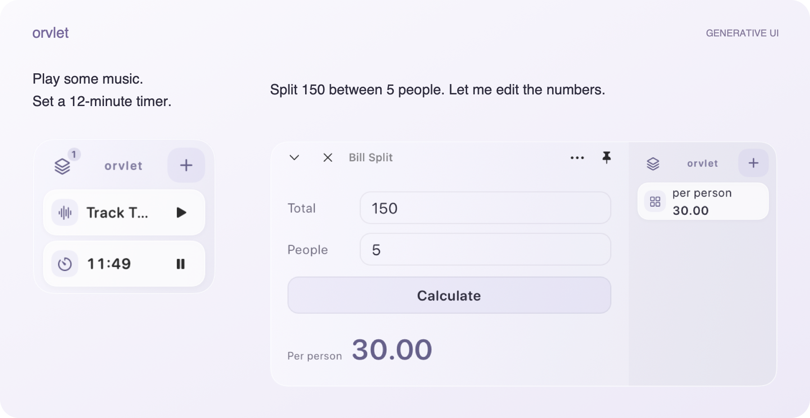

# Orvlet

A calm desktop agent for ongoing everyday tasks. Delegate a goal, return to your work, and come back to a small interface when you need to check or adjust it.

[简体中文](README.zh-CN.md) · macOS · Generative UI · [Watch the film ↗](https://claslove.github.io/Orvlet/)

## Calm Agent

Calm Agent is a design framework for **intermittent human attention**. An auxiliary task may run for minutes or hours while its user attends to it for only a few seconds at a time. The task should continue within its delegated scope, preserve its context, and make its current state and controls easy to find when the user returns.

Three on-demand interaction modes provide access to the same ongoing task:

| Mode | Purpose | Example |
| --- | --- | --- |
| **Delegate** | Express or revise a goal in language. | “Play some quiet music.” Later: “Switch to instrumental jazz.” |
| **Adjust** | Use an available control directly. | Pause playback or change a timer value. |
| **Check** | Inspect the current state without issuing a new instruction. | See what is playing, how much time remains, or whether input is needed. |

These modes connect through a persistent task representation: its goal, constraints, observable state, available actions, and execution history. Generative UI provides controls and feedback suited to an open-ended goal; familiar controls remain available for routine actions. Background execution updates the task between visits. When progress requires a decision or missing information, the request stays attached to that task.

Orvlet is the desktop prototype illustrating this approach. Background execution, compact task pills, expandable interfaces, and stored context let users move between primary work and brief moments of task control. Idle pills fade into the workspace periphery and regain prominence when interaction resumes. The aim is to keep ongoing tasks understandable and controllable while protecting attention for primary work.

[Watch the 78-second demo](https://claslove.github.io/Orvlet/) · [Open the video directly](https://claslove.github.io/Orvlet/media/orvlet-calm-agent.mp4)

The film follows a writing session with background music, a calendar request and clarification, and a change of music. It combines real prototype captures with a staged work scenario and shortened waiting periods. The framework is described in *Calm Agent: Designing for Intermittent Human Attention* by Dian Jin and Yancheng Yuan.

## Getting started

Configure a model in **Settings → Models**, then press **⌥ Space** to ask for something.
[Model connection options](docs/model-connections.md) cover custom providers, protocols and request parameters.

Click a card to expand it; press Esc or click outside to collapse. Pin it to keep it open, or drag it somewhere convenient. Common timers work without a model. Review Calendar and other access in **Settings → Access** before using those capabilities.

<strong>Controls & practical details</strong>

- Click a card to expand it; click again, press Esc, or click outside to collapse. Pin details to keep them open. Drag the stack to move it.
- Right-click for **Chat** or **Hide**; drag a card outside the stack to close it after the removal preview appears. Hiding a card keeps the task running; find it again in the task list. Closing a calendar card leaves the saved event intact.
- Choose a horizontal or vertical stack. Two tasks stay visible; the rest go into the task list. Idle opacity defaults to 55%, adjustable in **Settings → General → Inactive opacity**.
- Model and website response times vary. Up to three webpage tasks can stay live.
- The Chromium edition uses a guest session by default. To filter ads, install a compatible content blocker in **Settings → General → Browser → Extensions**.
- Generated calculations use time-limited JavaScript with no direct file, shell, or network access. Task interfaces and inputs stay on your Mac.
- Calendar creation checks for duplicates and reads the event back before reporting success. Without an explicit time zone, it uses Hong Kong time and prefers calendars named 工作 or 安排.

---

[Contributing & building](CONTRIBUTING.md) · [Architecture](docs/architecture/README.md) · [Privacy](PRIVACY.md) · [Third-party notices](THIRD_PARTY_NOTICES.md)
