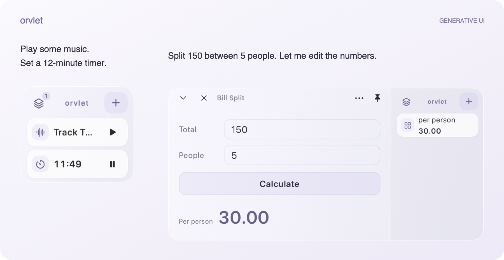

# Orvlet

A side-screen agent for music, schedules, and small everyday tasks. The interface is generated for what you ask it to do.

[简体中文](README.zh-CN.md) · macOS · Generative UI

## Getting started

Configure a model in **Settings → Models**, then press **⌥ Space** to ask for something.
[Model connection options](docs/model-connections.md) cover custom providers, protocols and request parameters.

Click a card to expand it; press Esc or click outside to collapse. Pin it to keep it open, or drag it somewhere convenient. Common timers work without a model. Review Calendar and other access in **Settings → Access** before using those capabilities.

<strong>Controls & practical details</strong>

- Click a card to expand it; click again, press Esc, or click outside to collapse. Pin details to keep them open. Drag the stack to move it.
- Right-click for **Chat** or **Hide**; drag a card outside the stack to close it after the removal preview appears. Hiding a card keeps the task running; find it again in the task list. Closing a calendar card leaves the saved event intact.
- Choose a horizontal or vertical stack. Two tasks stay visible; the rest go into the task list. Idle opacity defaults to 55%, adjustable in **Settings → General → Inactive opacity**.
- Model and website response times vary. Up to three webpage tasks can stay live. Ad filtering is enabled, though some ads may still appear.
- Generated calculations use time-limited JavaScript with no direct file, shell, or network access. Task interfaces and inputs stay on your Mac.
- Calendar creation checks for duplicates and reads the event back before reporting success. Without an explicit time zone, it uses Hong Kong time and prefers calendars named 工作 or 安排.

---

[Contributing & building](CONTRIBUTING.md) · [Architecture](docs/architecture/README.md) · [Privacy](PRIVACY.md) · [Third-party notices](THIRD_PARTY_NOTICES.md)
