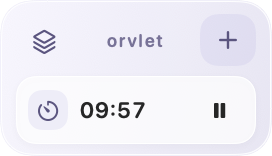

# Orvlet

**A calm agent for the edge of your desktop.**

Orvlet helps with small, ongoing tasks—music, timers, schedules, and useful information from webpages—while you focus on something else. Ask through a temporary command window, then leave the useful controls and information beside your work.

The interface is generated for the task: a player for listening, a clock for checking the time, a few useful actions when you need them. Playback controls and timer updates run locally, without waiting for another model response.

[简体中文](README.zh-CN.md)

## The experience

- **Ask, then return to work.** ⌥ Space opens an independent command window. Submitting dismisses it immediately; a preparation card appears while the agent works in the background.
- **Keep common actions close.** Pause music or a timer directly from the compact stack. Listening tasks keep their music card through track changes and temporary player reloads. Open the player card for more, or choose to view the original webpage.
- **Let the interface fit the task.** Generated cards arrange useful controls and live readings from the actual page, with a consistent appearance. Information such as time keeps updating after the card is generated.
- **Take up less attention.** Choose a vertical or horizontal stack. Two tasks stay visible; the rest remain in the task list. After three seconds without interaction or focus, the stack fades to a configurable opacity—55% by default—and becomes clear again when you use it.
- **Start lightweight tasks immediately.** Common timer requests run locally. Calendar entries are added to Apple Calendar, checked for duplicates, and read back before success is reported.

## Everyday controls

Click a task to expand it. Click the same entry again, press Esc, or click outside to collapse it. Pin details to keep them open. Drag compact text, controls, or background to move the stack; dragging does not activate the control.

Right-click a task to close it. Hiding a card leaves its task running. Use the stack button to find tucked-away tasks.

Adjust **Settings → General → Inactive opacity** to change idle transparency. Set it to 100% to keep the stack fully visible.

## Using Orvlet

Configure a model in **Settings → Models** for webpage tasks. Results and response time depend on the model and website. Timers and existing playback controls run locally.

The built-in browser keeps up to three webpage tasks live. Ad filtering is enabled by default, and YouTube's skip button is used when available. Some ads can still appear.

Adding a schedule requires permission to access Apple Calendar. When no time zone is specified, Orvlet defaults to Hong Kong time and prefers calendars named 工作 or 安排. Closing a calendar card does not delete the event.

---

[Privacy](PRIVACY.md) · [Third-party notices](THIRD_PARTY_NOTICES.md)
