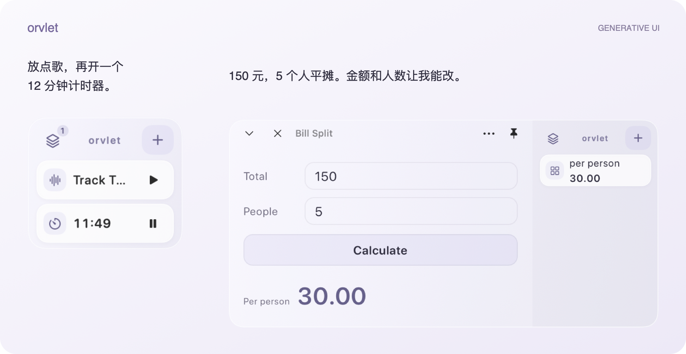

# Orvlet

一个放在桌面旁边的「副屏 Agent」。放歌、记日程、做点简单计算，界面随任务生成。

[English](README.md) · macOS · Generative UI

## 开始使用

在 **Settings → Models** 配置模型，按 **⌥ Space** 输入请求。

点卡片展开，按 Esc 或点外面收起。需要一直看就固定住，位置可以拖动。常见计时无需模型；可提前在 **Settings → Access** 检查日历等功能的权限。

<strong>操作与使用细节</strong>

- 点击卡片展开；再点一次、按 Esc 或点击外部收起。固定后保持展开，拖动任务栈可调整位置。
- 右键提供 **Chat** 和 **Hide**；把卡片拖出任务栈，出现移除预览后松开可关闭任务。隐藏卡片会保留后台任务，可从任务列表找回；关闭日程卡片不会删除已保存的日程。
- 支持横竖排列，同时显示两项任务，其余收入列表。闲置透明度默认为 55%，可在 **Settings → General → Inactive opacity** 调整。
- 响应速度受模型和网站影响。最多同时保留三个网页任务；默认启用广告过滤，但部分广告仍可能出现。
- 生成的计算使用有时限的 JavaScript，不直接访问文件、终端或网络。任务界面和输入保存在本机。
- 添加日程时会查重，并读回确认。未指定时区时使用香港时间，优先选择“工作”或“安排”日历。

---

[贡献与构建](CONTRIBUTING.md) · [架构导览](docs/architecture/README.md) · [隐私说明](PRIVACY.md) · [第三方说明](THIRD_PARTY_NOTICES.md)
