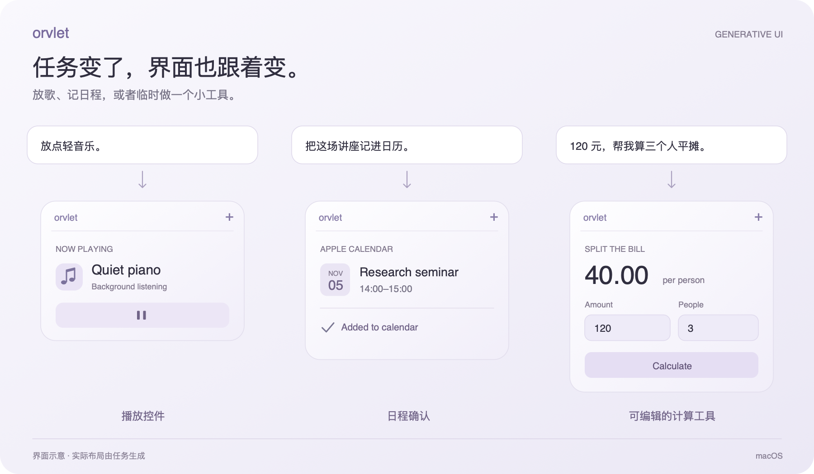

# Orvlet

一个支持日常持续任务的桌面 Agent。交代目标后继续手头的工作，需要查看或调整时，再回到一个小巧的任务界面。

[English](README.md) · macOS · Generative UI · [观看宣传片 ↗](https://claslove.github.io/Orvlet/)

## Calm Agent 的概念

Calm Agent 是一种围绕**间歇性注意力**设计 Agent 交互的框架。辅助任务可能持续几分钟甚至几小时，用户却只需要偶尔花几秒钟关注它。任务应在委托范围内继续运行、保留上下文，并让用户回来时能迅速理解当前状态、找到所需操作。

用户可以按需通过三种方式访问同一个持续任务：

| 方式 | 用途 | 例子 |
| --- | --- | --- |
| **Delegate · 委托** | 用自然语言表达或修改目标。 | “放点安静的音乐。”之后再说：“换成器乐爵士。” |
| **Adjust · 调整** | 直接使用已有控件。 | 暂停播放，或修改计时器数值。 |
| **Check · 查看** | 查看当前状态，无需发出新指令。 | 看正在播放什么、还剩多久，或是否需要补充信息。 |

三种交互由同一个持久任务表示连接：目标、约束、可观测状态、可用操作及执行历史。生成式 UI 为开放式目标提供合适的控件与反馈；日常操作则复用熟悉的控件。用户离开界面后，后台执行仍可更新任务。需要用户决策或补充信息时，请求也保留在原任务中。

Orvlet 是这一框架的桌面原型。它通过后台执行、小巧的任务胶囊、可展开的界面及保存的上下文，支持用户在主要工作与短暂的任务操作之间切换。闲置时，任务胶囊降低透明度、退到注意力边缘；交互恢复时重新清晰呈现。设计目标是让持续任务随时可理解、可控制，同时为主要工作保留注意力。

[观看 78 秒宣传片](https://claslove.github.io/Orvlet/) · [直接打开视频](https://claslove.github.io/Orvlet/media/orvlet-calm-agent.mp4)

宣传片围绕一段写作过程，展示背景音乐、日历委托与澄清，以及音乐切换。视频结合真实原型录制与虚构工作场景，并缩短部分等待过程。概念详见 Dian Jin 与 Yancheng Yuan 的论文 *Calm Agent: Designing for Intermittent Human Attention*。

## 开始使用

在 **Settings → Models** 配置模型，按 **⌥ Space** 输入请求。

点卡片展开，按 Esc 或点外面收起。需要一直看就固定住，位置可以拖动。常见计时无需模型；可提前在 **Settings → Access** 检查日历等功能的权限。

<strong>操作与使用细节</strong>

- 点击卡片展开；再点一次、按 Esc 或点击外部收起。固定后保持展开，拖动任务栈可调整位置。
- 右键提供 **Chat** 和 **Hide**；把卡片拖出任务栈，出现移除预览后松开可关闭任务。隐藏卡片会保留后台任务，可从任务列表找回；关闭日程卡片不会删除已保存的日程。
- 支持横竖排列，同时显示两项任务，其余收入列表。闲置透明度默认为 55%，可在 **Settings → General → Inactive opacity** 调整。
- 响应速度受模型和网站影响。最多同时保留三个网页任务；默认启用广告过滤，但部分广告仍可能出现。
- 生成的计算使用有时限的 JavaScript，不直接访问文件、终端或网络。任务界面和输入保存在本机。
- 添加日程时会查重，并读回确认。未指定时区时使用香港时间，优先选择“工作”或“安排”日历。

---

[贡献与构建](CONTRIBUTING.md) · [架构导览](docs/architecture/README.md) · [隐私说明](PRIVACY.md) · [第三方说明](THIRD_PARTY_NOTICES.md)
