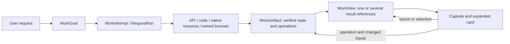

# Work, execution, results, and views

`WorkRepository` is the durable store. `SideTask` is the shell projection and a
compatibility adapter for existing native resources; it is no longer the owner
of API results or generated tool state.

A goal retains the complete request. Card placement does not create isolated
executors or discard shared conditions. Attempts record execution separately.
Results retain their definition, values, revision, source evidence, and runtime
state. A view references result IDs and owns its layout, selection, visibility,
input draft, and optional markup override. A result can have zero, one, or several
views; multiple goals can refer to the same retained result.

## Boundaries

- Source tools commit verified results before rendering. `present_results`
  chooses separate, together, or selectable views without rerunning acquisition.
  Grouping a single result retains its complete controls.
- Delivery is tracked for the goal, not individually for every source artifact.
  A verified interactive tool can finish delivery while keeping intermediate
  results without views. Acquiring another result reopens the delivery check.
- `inspect_results` finds work without requiring a visible card. `operate_result`
  and rendered controls call the same registered operation by result ID.
- Definitions own input contracts and operations. Markup does not decide which
  operations exist. Invalid markup cannot disable a saved operation.
- Inputs being edited are view drafts. Failed edits keep the previous verified
  result; the draft cannot relabel an old value as a newly verified result.
- Result commits reject superseded operations. Runtime samples do not invalidate
  an unrelated operation merely by updating a clock field. Runtime persistence
  uses the existing checkpoints instead of rewriting the store each frame.
- Editing markup and switching selected results do not restart execution.
  Closing a view retains its resource. Explicit stopping cancels execution;
  a scheduled source can be stopped even after its last view is closed.
- Hidden views remain in Tasks and can be shown again. Closed views retain a
  durable `closed` marker and are excluded from Tasks, capsule counts and shelf
  sizing. Result projection and native resource checkpoints cannot reopen them.
  An explicit user presentation can reopen the same identity. Visibility changes
  update the repository as well as the shell projection.
- A source browser is an execution resource. Publishing a local result after
  browsing preserves the original requested view destination. A newly created
  auxiliary page leaves the visible list after successful publication; its
  resource remains available. Pre-existing pages and media resources are kept.

`present_ui` remains an adapter for generated local tools: the host validates
behavior, stores the definition/state, then projects the interface. `run_code`
retains successful intermediate output separately, so subsequent presentation
failure cannot erase it. Source templates and controls are compiled by
`DataToolPlan`; the model does not need to generate state keys or wrappers.

## Compatibility and limits

Legacy shelves import into the repository once, retaining visible IDs. Existing
native timers, calendar records, and owned pages still use their established
executors and a `SideTask` resource snapshot behind the adapter. Their resource
IDs remain independent of additional views. This change does not replace the
browser engine or change user handoff policy.

The agent still makes semantic decisions and external services can fail. A
retained value is not automatically fresh just because a new view was created.
Source timestamps, execution verification, bounded recovery, and write receipts
remain separate checks. This architecture is not a guarantee that every model
plan or arbitrary website operation succeeds.

## Checks

`WorkSeparationCheck` exercises execution without a view, shared results,
actual WebKit selection, broken markup, view-only changes, stale commits,
persistence, and independent native timer lifetime. `APIDataCheck` checks source
validation and changed inputs against the authoritative result store.
`TaskDismissalCheck` uses rendered native buttons and AppKit pointer events for
hide/show, opening a hidden row, title reordering, Escape cancellation, closing,
and dragging both a shelf title and compact card outside. It checks late result
updates, timer ticks, restored state and retained results after removal.
`ParallelCardsCheck` submits real commands through `sendCommand`, invokes actual
rendered controls, and compares displayed values and card IDs. Live acceptance
must report failures as well as successes; a fixture count is not a substitute.
